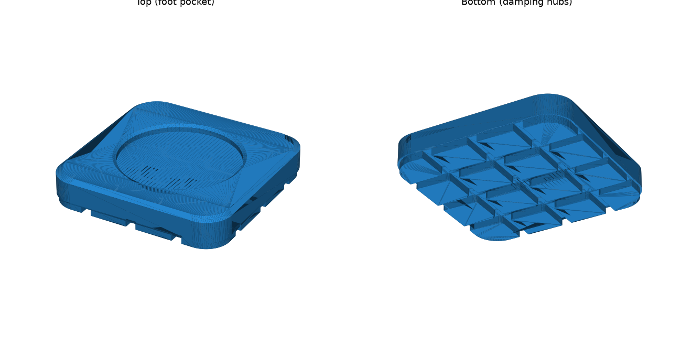

# ฐานรองขากันสั่น Kobra 2 Pro (eSUN TPU 95A)



- ไฟล์: `kobra2pro_tpu_foot.stl` (ปริ้นทั้งหมด 4 ชิ้น)
- ขนาด 55 × 55 × 13 มม. หลุมรับขาเครื่องกว้าง Ø36 ลึก 3 มม.
- ด้านล่างแบ่งเป็นปุ่ม 4×4 ปุ่ม เวลารับน้ำหนัก ปุ่มแต่ละอันจะบานออกด้านข้างได้ ฐานจึงยุบตัวได้ง่ายกว่าก้อนตัน และซับแรงสั่นได้ดีกว่า
- ไส้ในตั้งเป็น gyroid แบบโปร่ง ใช้ TPU ราว 13–14 ก./ชิ้น หรือประมาณ 55 ก. สำหรับ 4 ชิ้น

## ค่าที่แนะนำใน slicer

| ค่า | ตั้งเป็น |
|---|---|
| Layer height | 0.2 มม. |
| Wall loops | 2 |
| Top / Bottom layers | 3 / 3 |
| Infill | **Gyroid 10–15%** (ยิ่งน้อยยิ่งนุ่ม ซับแรงสั่นได้ดี) |
| Speed | 20–30 มม./วิ. |
| Nozzle / Bed | 220–230 °C / 40–50 °C |
| Retraction | ปิด หรือตั้งต่ำมาก (≤1 มม.) |
| Cooling fan | 50–100% |
| Support | ไม่ต้องใช้ (วางด้านปุ่มลงบนฐานพิมพ์) |

## ปรับขนาด

ให้วัดขายางเดิมของเครื่องก่อน ถ้าขาใหญ่กว่า 34 มม. ให้แก้ค่า `POCKET_D` ใน `make_foot.py` แล้วรันใหม่ ค่าที่ใส่ควรเท่ากับขนาดขาบวกเพิ่มราว 2 มม.

```bash
pip install manifold3d trimesh numpy
python3 make_foot.py
```
